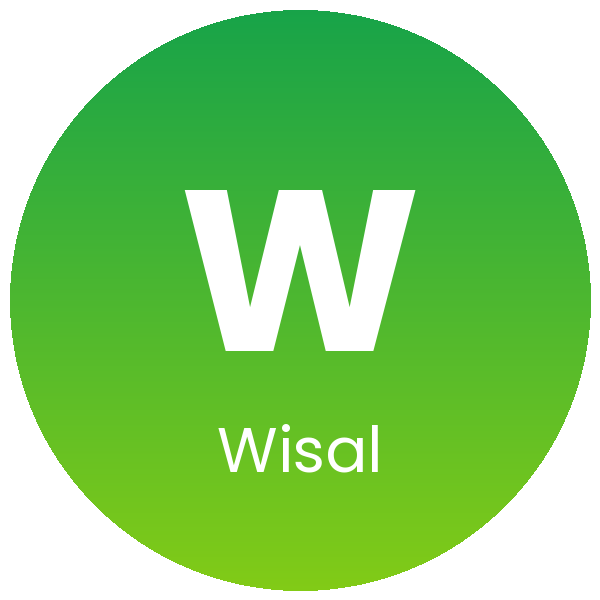

  

  

<h3 align="center">🏛️ Wisal · Digital Public Service Improvement Platform</h3>

      

---

## 📌 Overview

Wisal is a digital platform that designs solutions to improve the accessibility and efficiency of public services for citizens and residents in Najran.

---

## ❓ The Problem

Reaching public services is not always easy. Citizens and residents can face complicated steps, long waits, or difficulty finding the right service, which affects their experience and the efficiency of the service itself.

## 💡 Our Solution

Wisal connects people with public services through one digital platform. It focuses on making services easier to reach and faster to complete, so the experience improves for both the people using them and the teams providing them.

---

## ✨ Key Features

<table>
  <tr>
    <td width="25%" align="center" valign="top"><h2>🌐</h2><b>Digital platform</b> One place to reach public services in Najran.</td>
    <td width="25%" align="center" valign="top"><h2>♿</h2><b>Accessibility</b> Makes public services easier to reach for everyone.</td>
    <td width="25%" align="center" valign="top"><h2>⚡</h2><b>Efficiency</b> Aims to make service delivery faster and simpler.</td>
    <td width="25%" align="center" valign="top"><h2>🤝</h2><b>Built for the community</b> Designed for citizens and residents of Najran.</td>
  </tr>
</table>

---

## 🏆 Achievements

| | Achievement |
| :---: | --- |
| 🏅 | **Recognized by the Regional Governor** |
| 🥉 | **3rd Place** |

---

## 🌍 Impact Areas

Digital government · Smart cities · Saudi Vision 2030

---

## 👩‍💻 Team

Built by **[Roz Alomar](https://github.com/RSA445)**, AI Solutions Builder and Information Systems student at Najran University.

  
  
  

  

